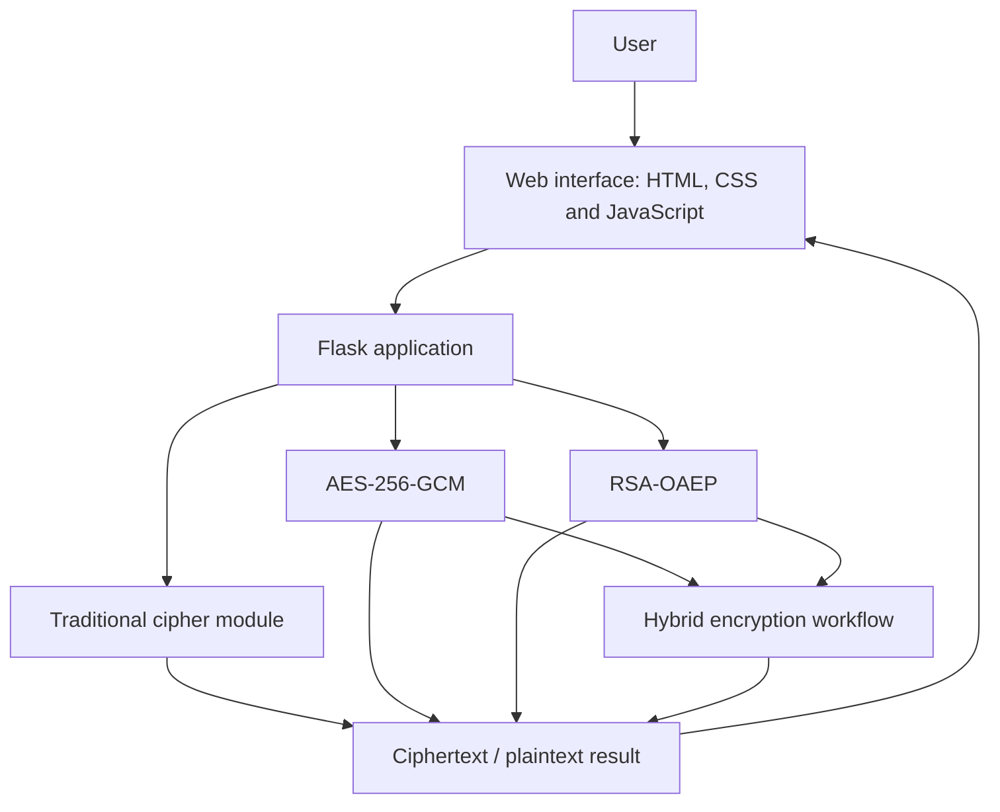
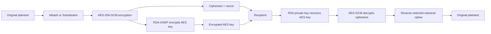

# System Design

## Architecture

## Data flow

1. The user selects an encryption method.
2. The user enters plaintext and, when required, a public key.
3. JavaScript sends the request to the Flask backend.
4. The backend validates the request and performs the selected operation.
5. The backend returns the result as JSON.
6. The browser displays the ciphertext or decrypted plaintext.

## Integration logic

The application provides one interface and a common request/response structure for all algorithms. The selected algorithm determines which cryptographic operation is performed. The traditional methods operate on characters, AES-GCM operates on message bytes using a shared secret, and RSA-OAEP uses a public/private key pair. Hybrid encryption combines AES-GCM and RSA-OAEP by encrypting the message with AES and wrapping the AES key with RSA.

## Traditional and modern integration sequence

The classical cipher must be reversed only after AES decryption. The order matters because decryption reverses the encryption sequence.
